<div align="center">

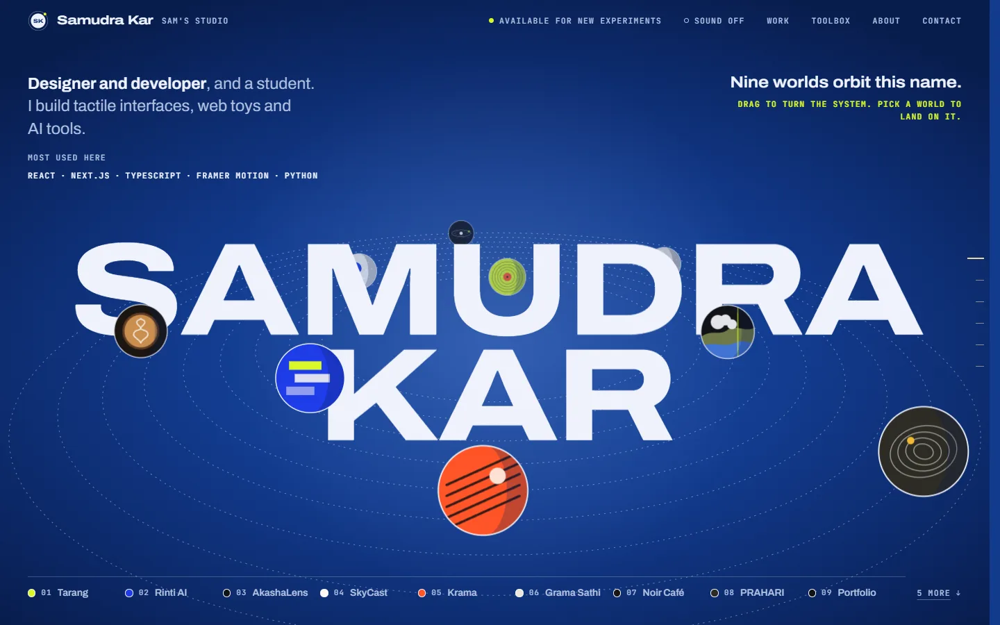

<br />
<br />

# Samudra Kar, portfolio

**A small universe around a name: nine projects orbit SAMUDRA KAR, and each one is its own world you can land on.**

Nine interactive project worlds · five more projects drawn as bodies on the same instrument · a toolbox built from the projects themselves · a hidden door

<br />

[**Live site**](https://sam-sportfolio.vercel.app) &nbsp;·&nbsp; [The tour](#the-tour) &nbsp;·&nbsp; [The worlds](#the-worlds) &nbsp;·&nbsp; [How it works](#how-it-works) &nbsp;·&nbsp; [Run it](#run-it-locally) &nbsp;·&nbsp; [Design system](#design-system)

<br />


</div>

---

## What this is

The portfolio is one working instrument: a **cyanotype orrery** with the studio (the SK monogram) at the centre and the projects on its rings. Cyanotype is the old sun-print process: Prussian blue where light hit the paper, white where it did not. The site is printed on the blue; the quiet passages (About, the case-study write-ups) sit on the white.

The rules: white hairline linework, dashed for available and solid for committed, every project an enamel disc in its own colour, one typeface (Archivo) across its width axis, and hierarchy carried by type size, not by boxes. Nothing moves just because it can.

## The tour

### 1. The homepage: a small universe around the name

The first screen is the experience, not a header. **SAMUDRA KAR** sits at the centre of a system of nine tilted rings drawn in perspective: the near half of every ring passes *in front of* the name and the far half behind it, so the identity sits inside the scene. Each featured project is a planet whose surface is drawn from what the project is (record grooves for Tarang, stacked sources for Rinti AI, terrain under cloud for AkashaLens, a latte rosetta for Noir Café, the contours of a mine for PRAHARI, and so on).

- **It is alive but calm.** The rings turn slowly, inner worlds faster than outer ones (angular speed falls off with ring size). A fast scroll makes them race briefly.
- **Drag anywhere to turn the system**, with momentum when you let go. A click on empty space returns to the overview.
- **Pick a world** (click its planet, or use the rail of named buttons along the bottom). The planet flies out of its orbit to the focus slot, the name and the other worlds recede, and a panel opens with its category, an accurate description, the stack and its real links: enter its chapter, the case study, GitHub, and the live demo where one is verified. Previous and Next walk the worlds; Escape or "All worlds" closes.
- **Keyboard:** the rail is ordinary buttons; arrow keys walk the worlds, Escape closes.
- **Entrance:** once per session the name prints in and the system forms out of the centre in under a second. Any key, wheel or touch finishes it at once; reduced motion skips it.
- **Scrolling on** flattens the rings toward edge-on as the hero leaves, and the index of worlds follows. Scrolling is never hijacked.

On phones the same universe is recomposed for a thumb: the scene sits on top, the worlds become a swipeable row of named buttons, and the open world's panel follows below, so nothing depends on hitting a small planet.

<table>
  <tr>
    <td width="70%">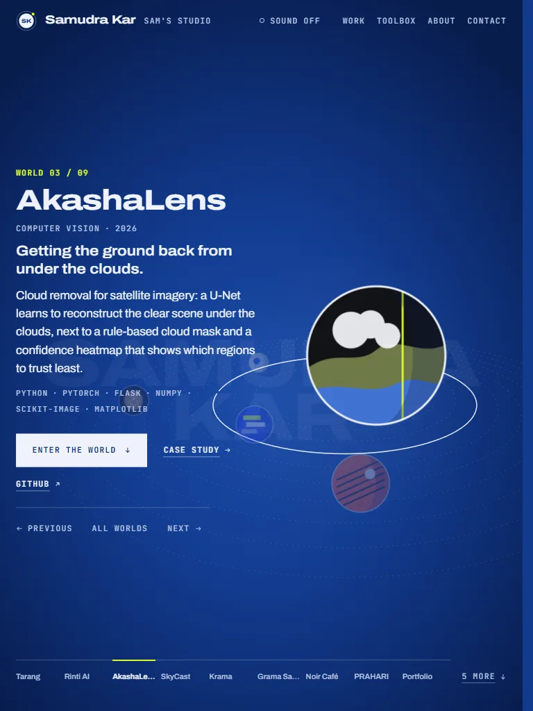</td>
    <td width="30%">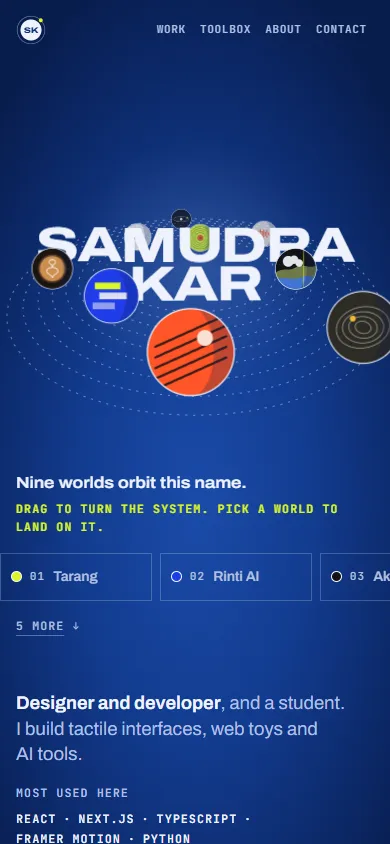</td>
  </tr>
  <tr>
    <td><sub>A world in focus: its planet takes the slot, its panel opens with the real links.</sub></td>
    <td><sub>On a phone.</sub></td>
  </tr>
</table>

### 2. Worlds: an index, then nine chapters that cover each other

The index lists the featured worlds; hovering a row floods it with that world's colour and turns the planet plate beside it. Then each project is a pinned, full-height chapter that slides up over the previous one, opening with its own mask. A small engraving of the orrery in the corner shows which ring you are on.

<table>
  <tr>
    <td width="50%">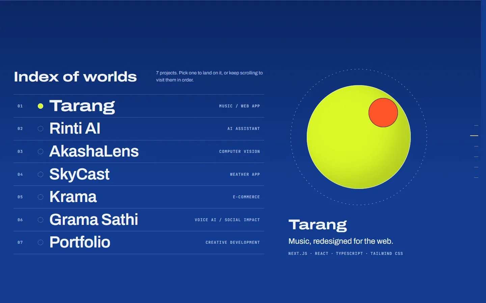</td>
    <td width="50%">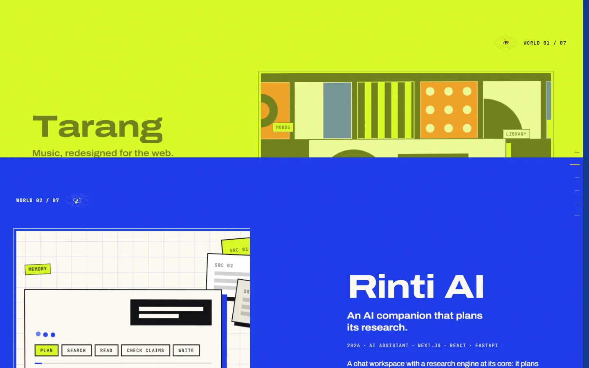</td>
  </tr>
</table>

### 3. More work: everything else on GitHub that earned a place

Five more projects (hackathon builds, an interface exploration, a live café site, team coursework) and two earlier sites. They have no interactive world yet, so each is drawn as a body on its own ring: a plate from the same instrument, never a fake screenshot. Team work always names the team and his role. The full repository audit behind this list is in [`docs/github-project-audit.md`](docs/github-project-audit.md).

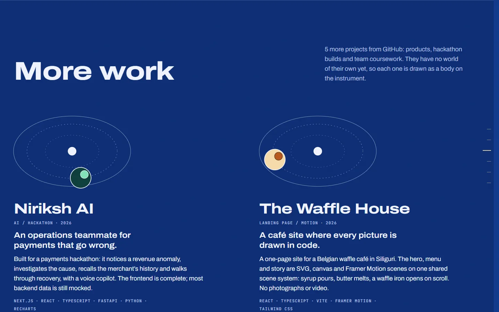

### 4. Toolbox: organised, and it can't lie

Every tool in every project's `tech` list, filed into six groups (Languages, Interface, Motion & 3D, Backend & data, AI & vision, Hardware) and ordered by use. Beside each tool sits one enamel disc per project that uses it, so "how much" is the real list of projects, not a skill bar. It works both ways: point at a tool to light up its projects, or at a project to light up the tools it was built with; click to pin. Anything a project lists that no group names lands in "Other" instead of disappearing. It is computed from the project data, so it can only show what the work actually used.

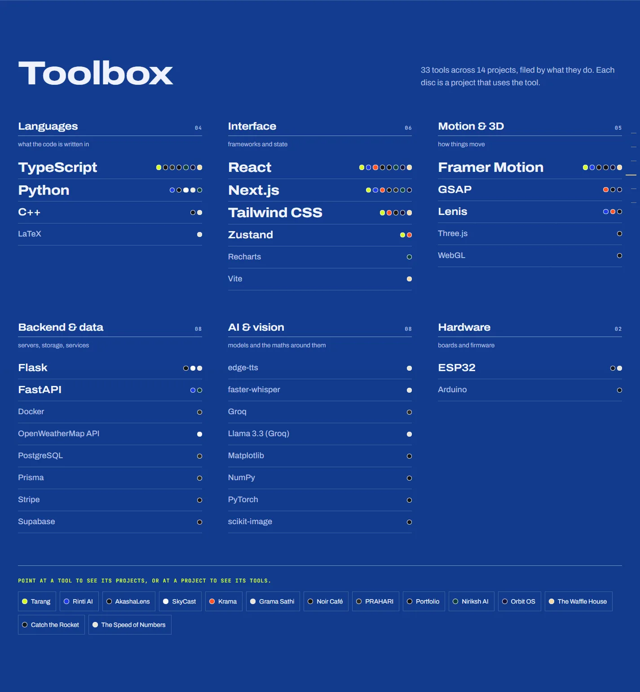

### 5. About: a desk on the white sheet

On desktop the stage pins and the objects land one by one as you scroll: an ID card printed in cyanotype blue, index cards for each facet (drag them anywhere), a sun print, a cassette (Now Playing), a lime note (Currently Building) and the studio seal. Somewhere on the desk is a door.

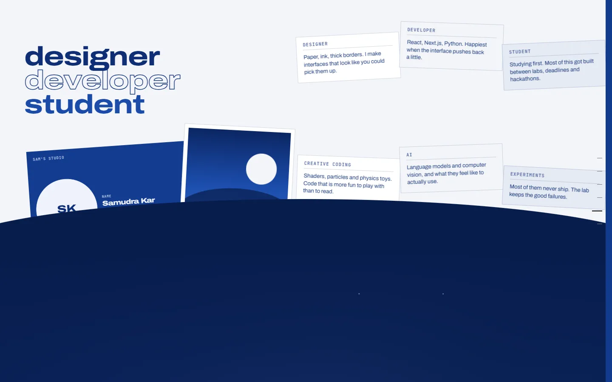

### 6. Contact: the deep end of the print

Three big rows (**Instagram, GitHub, LinkedIn**) on night blue. Hovering a row sweeps a white plate across it and rolls its letters, and **an enamel body behind it changes colour and shape** to match the link. Links come from `contact` in [`src/data/config.ts`](src/data/config.ts); a missing one simply isn't shown.

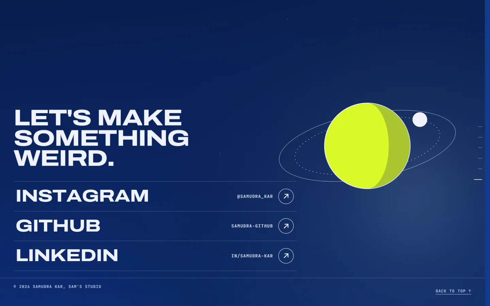

### 7. Kage: one hidden door

Somewhere on the About desk is a faint mark. (Or type `kage` anywhere.) Open it and you're in **Kage**, a full scroll-storytelling scene. Escape or the Back button returns you to exactly where you were.

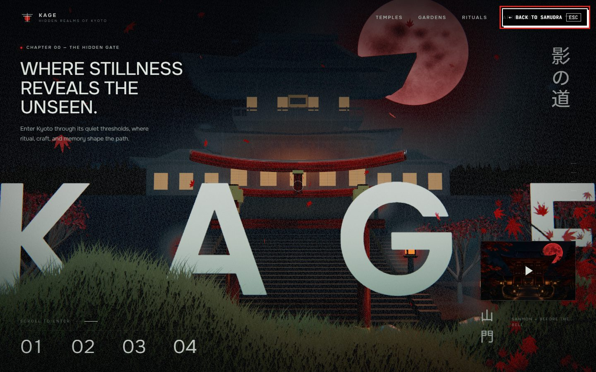

## Pages

The site is one sun print being made: a cyanotype (iron-salt paper that turns Prussian blue in light and stays white where something covers it).

| Route | What it is |
| --- | --- |
| `/` | Identity only, and something to do. A full-screen WebGL cyanotype: the pointer is the lamp. Three things lie on the sheet and cast photogram shadows that swing with it: a real little browser that pages through the featured work (its real addresses; arrows, ← → or a swipe), a sound wave, and a lens. **Hold anywhere (or the Hold to expose button with Space) to expose a print:** the blue deepens, shadows sharpen, the lens closes and its lime meter fills; let go and that photogram is fixed on the sheet. The layers drift at different depths. Any key, click or wheel skips the entrance. |
| `/projects` | The exhibition: all 16 projects as live SVG specimens. Wall view (prints lean toward the pointer and develop from blue to colour as they scroll in) or Index view (a fast list with a hover preview). Filters per kind (`?room=ai`), each with its own light. Picking a print opens a full-screen viewing room with a shared-element transition; arrow keys step through, Escape puts it back. `?p=slug` opens straight into it. |
| `/about` | A contact sheet: seven frames from one roll (designer, developer, student, photography, creative coding, AI, experiments) with a loupe; what is on the bench now; the toolbox. Arrow keys walk the frames. |
| `/contact` | The last print, at night: the WebGL field and enamel orb answer the channel you aim at; Instagram, GitHub and LinkedIn as tall rows. Email shows automatically once `config.contact.email` is filled in. |
| `/work/:slug` | Case studies, including the interactive worlds. |

The motion system (springs and curves by purpose) is in `src/lib/motion.ts` and `src/styles/tokens.css`. Project categories are in `src/data/kinds.ts`.

## The worlds

Every featured project is a small interactive scene with **its own motion personality and its own visual language**, driven by scroll, cursor, hover and scroll velocity. All of them run from the same `SceneContext`, so the scene in a chapter and the large one on the case-study page are the same component. The instrument frames them; it does not repaint them.

<table>
  <tr>
    <td width="33%">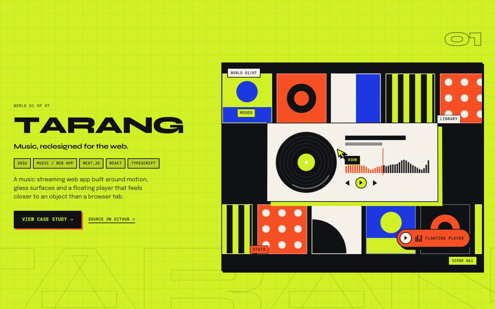</td>
    <td width="33%">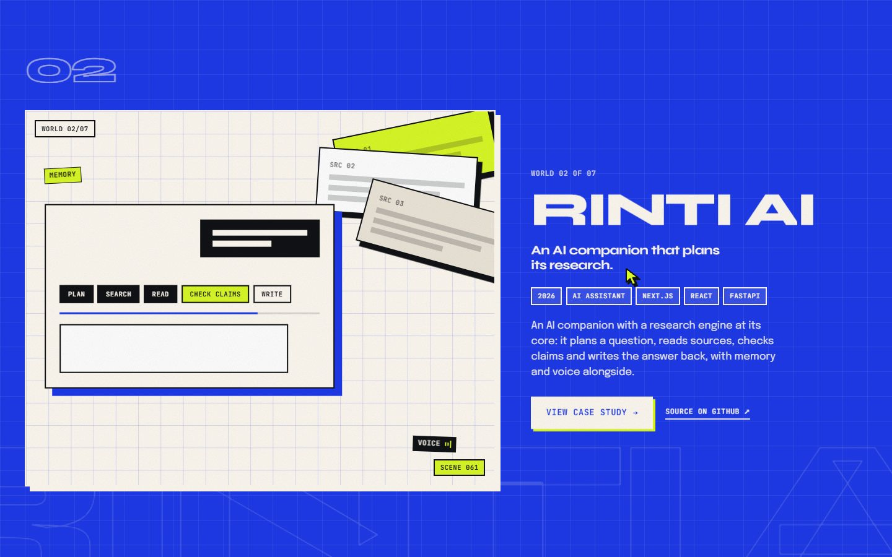</td>
    <td width="33%">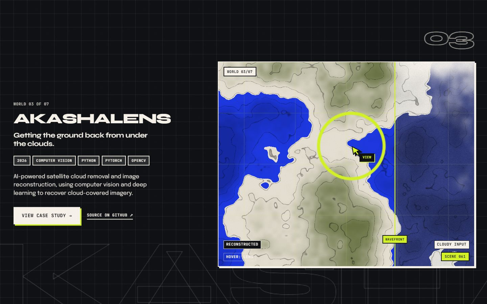</td>
  </tr>
  <tr>
    <td><b>Tarang</b><br /><sub>Rhythm. Album tiles drift sideways at two speeds, the record spins faster the harder you scroll, the waveform swells under the cursor, hovering scrubs the playhead.</sub></td>
    <td><b>Rinti AI</b><br /><sub>Conversation. One exchange plays as you scroll while the research pipeline (plan, search, read, check claims, write) lights up stage by stage.</sub></td>
    <td><b>AkashaLens</b><br /><sub>Reconstruction. A WebGL shader draws one landscape twice, cloudy and clean. A wavefront sweeps across on scroll, and a lens reconstructs under the cursor.</sub></td>
  </tr>
  <tr>
    <td width="33%">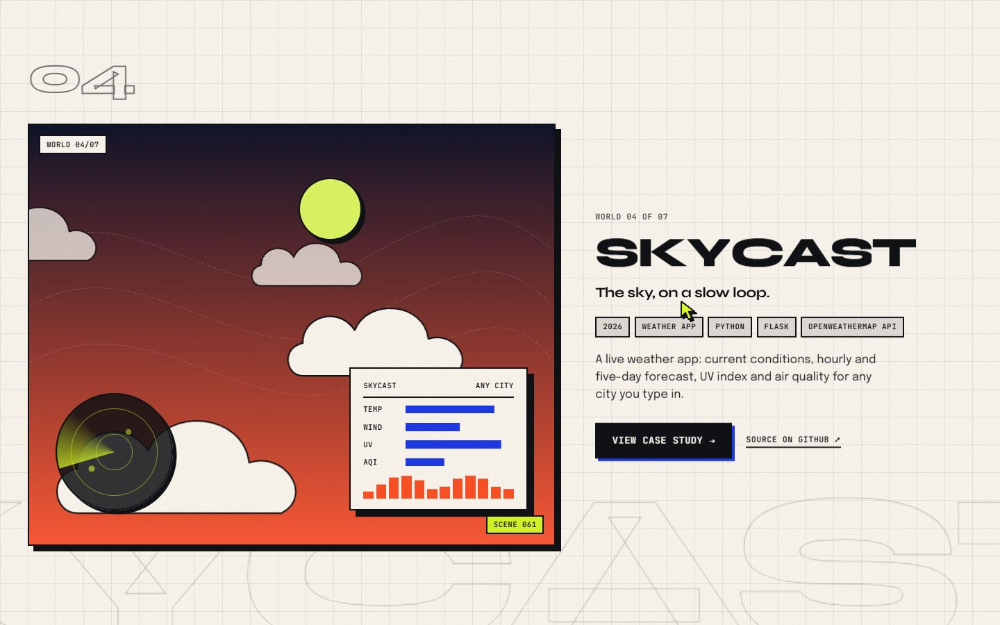</td>
    <td width="33%">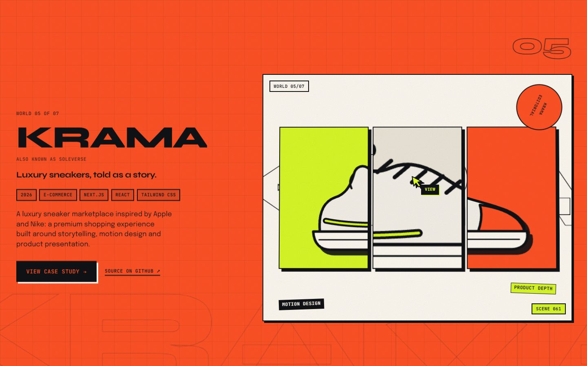</td>
    <td width="33%">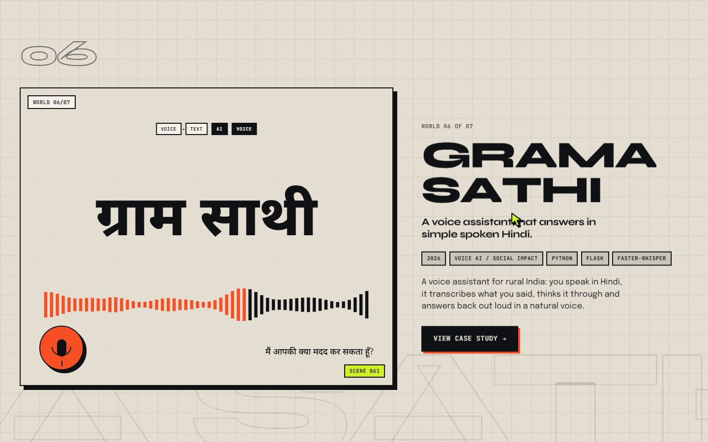</td>
  </tr>
  <tr>
    <td><b>SkyCast</b><br /><sub>Atmosphere. Scroll is time of day: dawn to night through the palette, a sun that becomes a moon, clouds on their own clock, a radar sweep.</sub></td>
    <td><b>Krama</b><br /><sub>Product depth. One sneaker sliced into three crop windows that assemble as you scroll and come apart again. The cursor magnifies a slice and tilts the product.</sub></td>
    <td><b>Grama Sathi</b><br /><sub>Voice. Idle, listening, replying, in Hindi (Devanagari). Scroll plays the loop; press and hold the mic to take over.</sub></td>
  </tr>
  <tr>
    <td width="50%" colspan="2">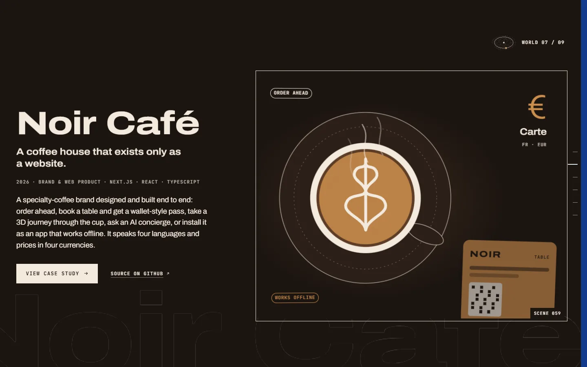</td>
    <td width="50%">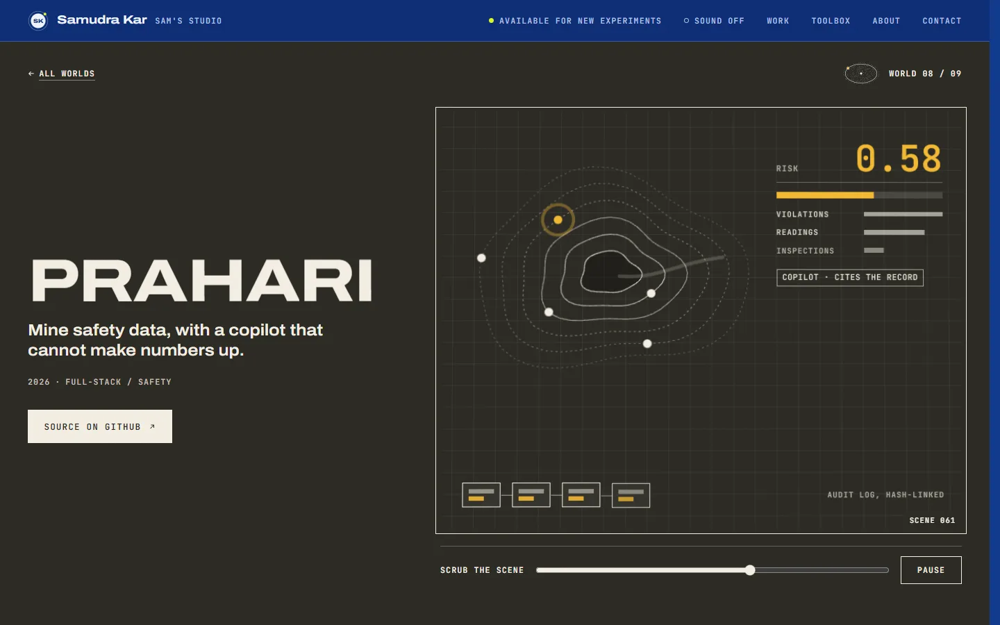</td>
  </tr>
  <tr>
    <td colspan="2"><b>Noir Café</b><br /><sub>Night service. Seen from above, scroll pours the latte art into the cup and the wallet-style pass for a booked table slides out from under the saucer. A menu plate turns through the four languages and currencies the site ships (EN/USD, JA/JPY, FR/EUR, IT/GBP). Steam leans toward the pointer.</sub></td>
    <td><b>PRAHARI</b><br /><sub>Inspection. An open pit as contour lines with sensors on its benches. Scroll runs one inspection: a sensor crosses its limit, the deterministic risk score climbs and lists its reasons, and each event is appended to a hash-linked audit chain.</sub></td>
  </tr>
</table>

**Portfolio** is the ninth, on the outermost ring: the site introduces itself with a squeezed headline whose role words roll over and a small copy of the orrery standing across it, turned by scroll and tipped by the pointer.

| Project | What it is | Source | Live |
| :-- | :-- | :-- | :-- |
| **Tarang** | Music streaming web app: a floating player, queue, synced lyrics, moods and stats | [Tarang](https://github.com/Samudra-GITHub/Tarang) | [tarang-ecru.vercel.app](https://tarang-ecru.vercel.app) |
| **Rinti AI** | Chat workspace with a cited research pipeline, per-user memory and real accounts | [Rinti-Ai](https://github.com/Samudra-GITHub/Rinti-Ai) | [rinti-ai.vercel.app](https://rinti-ai.vercel.app) |
| **AkashaLens** | U-Net cloud removal for satellite imagery; a prototype built for the ISRO Hackathon 2026 | [AkashaLens](https://github.com/Samudra-GITHub/AkashaLens) | |
| **SkyCast** | Flask weather app: conditions, forecast, UV and air quality | [SkyCast-Weather-App](https://github.com/Samudra-GitHub/SkyCast-Weather-App) | |
| **Krama** *(also SoleVerse)* | Editorial sneaker storefront front end: shop, cart, checkout, admin for drops | [Krama](https://github.com/Samudra-GITHub/Krama) | |
| **Grama Sathi** | A Hindi voice assistant: speak, it transcribes, thinks, and answers aloud | n/a | |
| **Noir Café** | A coffee brand that exists only as a website: order ahead, table booking, 3D cup, AI concierge, offline app, four languages | [noir-cafe](https://github.com/Samudra-GITHub/noir-cafe) | |
| **PRAHARI** | Mine safety and compliance: explainable risk score, a copilot that only narrates retrieved data, tamper-evident audit log | [PRAHARI](https://github.com/Samudra-GITHub/PRAHARI) | |
| **Portfolio** | This site | [Sam-s_Portfolio](https://github.com/Samudra-GITHub/Sam-s_Portfolio) | you're here |

> The scenes are visual interpretations of each project, not screenshots. The AkashaLens shader, for example, is a metaphor for cloud removal, not output from the model.

## Case studies

Every featured world and every "More work" project has a page at `/work/:slug`: the world (or the drawn plate) at large with a scrub bar, then what it is, what exists, its honest status and what it was built with, printed on the white sheet.

<table>
  <tr>
    <td width="50%">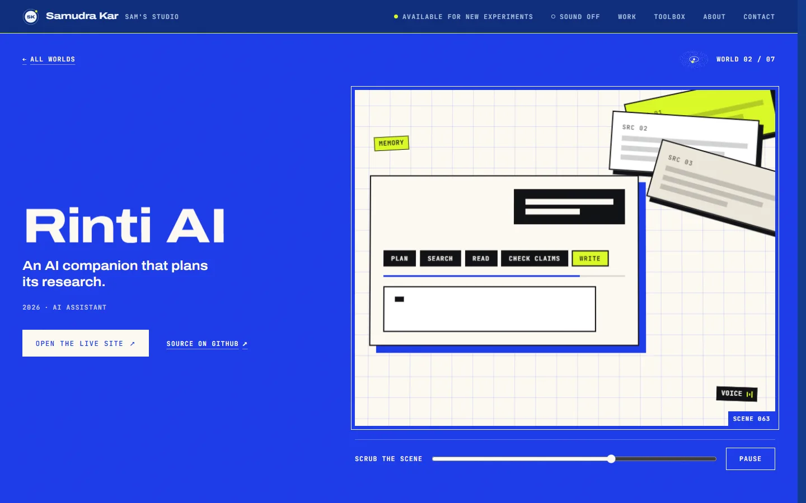</td>
    <td width="50%">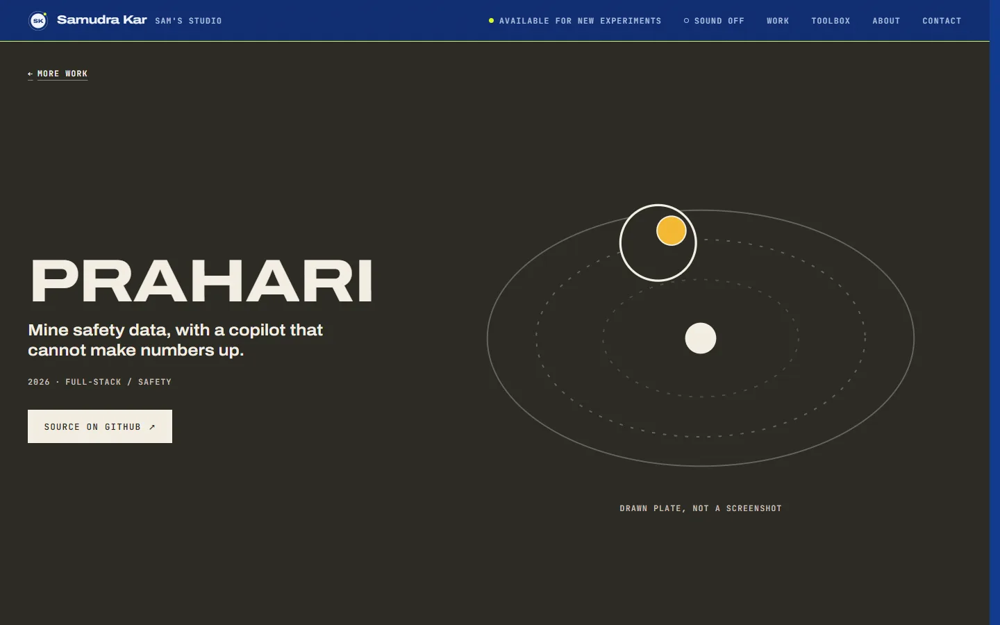</td>
  </tr>
</table>

## On small screens

Mobile isn't a scaled desktop. Below 1000px (or with `prefers-reduced-motion`) the pins and chapter overlaps are dropped: scenes stack, scroll still drives each scene. Below 600px the orrery becomes a numbered diagram and its names move to the readout and the index.

- **No horizontal scroll** at any phone width; checked at 390px and 320px.
- **Touch targets** of at least 44px, including small text links; on phones the worlds are a row of full-size buttons.
- **Cheaper shaders:** the canvases render at about 1x on phones, and every per-frame loop pauses offscreen.

<table>
  <tr>
    <td width="33%"></td>
    <td width="33%">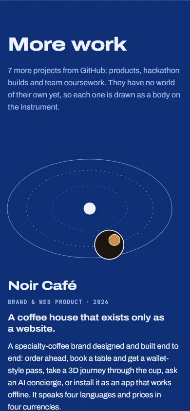</td>
    <td width="33%">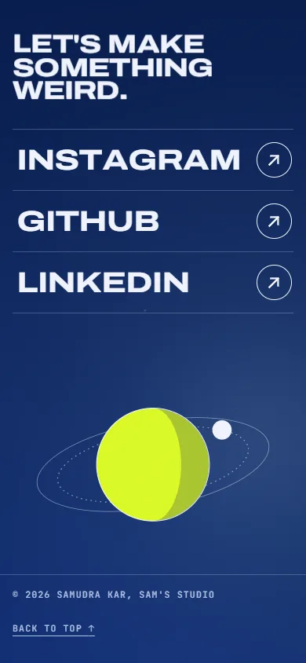</td>
  </tr>
</table>

## How it works

### Motion stack

Motion is split on purpose. **GSAP owns page-level choreography and Framer Motion owns component-level values. They never animate the same element.**

| Job | Tool |
| :-- | :-- |
| Smooth scroll and scroll velocity | **Lenis**, driven by GSAP's ticker |
| Pinned scenes, scrubbed timelines, masks, reveals | **GSAP + ScrollTrigger** |
| Cursor, hover and drag values, per-scene parallax | **Framer Motion** motion values |
| The homepage universe | Two canvases (far and near halves of the rings) around the name, planets as real buttons moved by transform only; one ticker callback that stops drawing when nothing moves or the hero is offscreen |
| Shader worlds and the Contact field | **Raw WebGL** (`ShaderCanvas`), no Three.js |
| Every per-frame effect | **One shared `gsap.ticker`**: a single `requestAnimationFrame` for the whole site |

Easing is two curves from `src/styles/tokens.css`: a strong ease-out (`cubic-bezier(0.23, 1, 0.32, 1)`) for anything arriving or answering a press, and a strong ease-in-out for things moving on screen. UI transitions stay between 140ms and 260ms; presses scale to 0.97; hover motion is gated to fine pointers.

### The scroll system (desktop)

- The homepage is a single 100svh scene and scrolling is never hijacked. As it leaves, the rings flatten toward edge-on and the copy fades.
- Each project chapter is a sticky stage inside a taller box. The **next chapter has a negative top margin**, so it slides up over the pinned one. The covered chapter scales back and is marked `inert` so keyboard focus can't land on something you can't see.
- Each chapter hands its world a `progress` value (0 to 1 across its whole scroll range). Worlds never read scroll or the pointer directly.

### The cursor

A white arrow with a blue hairline that reads on both the blue and the white sheet. It turns lime and tips toward anything you can use, and shows a small readout chip (ENTER, OPEN, TURN, VISIT) set by `data-cursor` and `data-cursor-label` attributes. It only runs on `(hover: hover) and (pointer: fine)` devices.

### Typography

Archivo is a variable font with a width axis (62% to 125%) as well as weight. Display type is set expanded, reading text at normal width, and the Portfolio world squeezes it. `ProximityText` gives every letter of the name its own slot sized for the resting weight; letters thicken under the cursor and swell past their slot, so the line never reflows.

### Performance and accessibility

- **Nothing runs offscreen.** Per-frame work is gated by `IntersectionObserver`, tab visibility and whether Kage is open.
- **WebGL is disciplined:** DPR is capped (lower on compact screens), context loss is handled, and the context is released on unmount.
- **Code splitting:** each world, the case-study page and Kage are separate lazy chunks.
- **Fonts are self-hosted** variable fonts (Fontsource); the Devanagari face loads only when the Grama Sathi world mounts.
- **Reduced motion** disables Lenis, pins, scrubs, the universe's drift and entrance, animated shaders and the page-transition curtain; chapters keep their two-column layout.
- Semantic landmarks, one `h1`, a skip link, visible lime focus rings, keyboard-operable controls, and accessible names that start with the visible text.
- Lighthouse 12 on the production build (`npm run build` + `vite preview`, home page, first visit with the entrance, 2026-10-20, two runs each): desktop 93 to 97 performance, 100 accessibility, 100 best practices, 100 SEO, CLS 0; mobile (simulated 4x CPU throttling) 63 to 69 performance, 100 / 100 / 100, CLS 0.

## Run it locally

```bash
git clone https://github.com/Samudra-GITHub/Sam-s_Portfolio.git
cd Sam-s_Portfolio
npm install
npm run dev
```

Open <http://localhost:5173>. The frontend needs no keys.

| Script | What it does |
| :-- | :-- |
| `npm run dev` | Verifies the Kage assets, then starts Vite |
| `npm run build` | Verifies the Kage assets, typechecks (`tsc -b`), builds |
| `npm run preview` | Serves the production build |
| `npm run lint` | `oxlint` |
| `npm run sync:kage` | Copies and hash-verifies the Kage assets (see below) |

### Optional backend

The site itself no longer needs a server: the Contact scene is plain social links. [`backend/`](backend) still holds the earlier Express contact API (the UI does not call it right now). To run it:

```bash
cd backend
npm install
cp .env.example .env     # then fill in the values below
npm run dev              # http://localhost:3000
```

If you wire a form back in, point the frontend at it with a root `.env` (defaults to `http://localhost:3000` if unset):

```env
VITE_BACKEND_URL=http://localhost:3000
```

### Backend API (optional)

A deliberately small Express + TypeScript service.

| Endpoint | Purpose |
| :-- | :-- |
| `GET /api/health` | Returns `{ "status": "ok" }` |
| `POST /api/contact` | Validates the message and emails it to you through [Resend](https://resend.com) |

`POST /api/contact` takes JSON:

```json
{ "name": "Ada", "email": "ada@example.com", "message": "Hello" }
```

- **Validation** (Zod): `name` 1 to 100 characters, a valid `email`, `message` 1 to 2000 characters. Failures return `400` with `error.code = "VALIDATION_ERROR"`.
- **Rate limit:** 10 requests per 15 minutes per IP on `/api/contact` (`429` with `TOO_MANY_REQUESTS`).
- **Hardening:** `helmet` headers, CORS pinned to `FRONTEND_ORIGIN`, and every user-supplied field HTML-escaped before it goes into the email body.
- Replies set `reply-to` to the sender, so you answer straight from your inbox.

| Variable | Meaning |
| :-- | :-- |
| `PORT` | Port to listen on (default `3000`) |
| `FRONTEND_ORIGIN` | Allowed CORS origin, e.g. your site URL (defaults to `*`, so set it in production) |
| `RESEND_API_KEY` | Your Resend API key |
| `RESEND_FROM` | Sender address (defaults to Resend's `onboarding@resend.dev`) |
| `CONTACT_EMAIL` | The inbox that receives messages |

`npm test` inside `backend/` runs the API tests against a server that is already running on `localhost:3000`.

## Deploy

| Part | Where | Config |
| :-- | :-- | :-- |
| Frontend | **Vercel** (live at <https://sam-sportfolio.vercel.app>) | [`vercel.json`](vercel.json) rewrites every path to `index.html` so deep links like `/work/krama` work |
| Contact API (optional, currently unused by the UI) | **Render** (web service) | [`render.yaml`](render.yaml): build `cd backend && npm install && npm run build`, start `cd backend && npm start`; secrets are set in the dashboard, not in the repo |

Only if you re-enable a form: set `VITE_BACKEND_URL` in the Vercel project to your deployed API URL.

## Make it yours

All content lives in `src/data/`, and **placeholders are hidden automatically**: any field still holding a `[PLACEHOLDER_…]` string is skipped by the UI (via `real()` in `src/lib/content.ts`), so nothing renders as broken text or a dead link.

| File | What to edit |
| :-- | :-- |
| `config.ts` | Name, studio, roles, About facets, *Currently building*, *Now playing* (set `track` and `artist` and the cassette appears on the desk and starts spinning; it stays hidden until then), and contact links (empty ones are hidden) |
| `projects.ts` | Every project: copy, tech, highlights, status, palette, links, and its `tier`. The Toolbox is generated from each project's `tech`. |

Each project has a `tier`:

| Tier | Where it appears |
| :-- | :-- |
| `featured` | A planet in the homepage universe, the index of worlds, a full chapter and a case study. Needs a `world` (a scene in `src/components/work/worlds/`, registered in its `index.ts`). |
| `more` | "More work", with a drawn plate and a case study. Set `lead: true` to give it more room. |
| `earlier` | A short line under "More work". |

Only add a `live` URL you have checked opens the right page. For team work, set `team` and `role` so the credit is never implied to be solo.

**Stress-testing the layouts (dev only):** on the dev server, add `?data=worst`, `?data=empty`, `?data=one` or `?data=many` to the URL, or use the toggle at the bottom of the page. It swaps in realistic worst-case project data (long titles, missing links, one tech, twelve techs, forty projects) from `src/data/stress.ts`. Production builds never read the parameter, and the toggle and fixtures are stripped from the bundle.

## Kage

The Kage scene is the authored `KageLandingPage` from [`@designcodeio/threeui`](https://threeui.com), used **unmodified**, with the same props. The component loads `/landing-pages/kage.html` from the site root, so [`scripts/sync-kage.mjs`](scripts/sync-kage.mjs) copies those files out of the package into `public/landing-pages/` and **verifies every file's sha256 against [`scripts/kage-landing-page.json`](scripts/kage-landing-page.json)**. It runs automatically before `dev` and `build` and fails loudly if anything doesn't match.

The scene is a lazy chunk, so visitors who never open it never download it.

## Project structure

```
.
├── backend/                 optional Express contact API (Resend, Zod, helmet, rate limit); not used by the UI right now
├── docs/                    github-project-audit.md, README screenshots
├── public/                  favicon (the SK mark), robots.txt, Kage's assets (synced + verified)
├── scripts/                 sync-kage.mjs (copy + sha256-verify Kage assets) and kage-landing-page.json (its manifest)
├── src/
│   ├── lib/                 runtime (media queries, pause), pointer, scroll, ticker hooks, gsap setup
│   ├── data/                config.ts, projects.ts (content), stress.ts (dev-only worst-case data)
│   ├── components/
│   │   ├── core/            SmoothScroll, Cursor, Monogram, Magnetic, PageTransition, ProximityText, Split, ShaderCanvas, Loader
│   │   ├── home/            the homepage universe and the planet surfaces
│   │   ├── work/            index, chapters, RingLocator, SceneFrame, worlds/ (one file per project)
│   │   ├── more/            More work and the drawn project plates
│   │   ├── stack/           the Toolbox
│   │   ├── about/           the desk
│   │   ├── contact/         the final scene (shader field + enamel body)
│   │   └── kage/            the hidden door (lazy) and its trigger
│   ├── pages/               Home, ProjectDetail, NotFound
│   └── styles/              design tokens and base styles
└── render.yaml · vercel.json
```

## Design system

| Token | Value | Role |
| :-- | :-- | :-- |
| `--cy-700` | `#123a8c` | the cyanotype ground |
| `--cy-950` … `--cy-500` | `#081c4a` … `#2a5cc0` | deeper and lighter blues: nav, Contact, light on the plate |
| `--line` | `#eef2fc` | text and engraved linework on the blue |
| `--line-2` | `#aebee2` | secondary text on the blue (5:1 on the ground) |
| `--sheet` / `--sheet-ink` | `#f3f5f9` / `#0e2d72` | the white sheet and the blue that prints on it |
| `--lime` | `#d8f827` | the one signal colour: conjunction, focus, selection |
| World enamels | lime, cobalt, ink, paper, vermilion, sand, plus each "More work" project's own | project discs and chapter grounds |

**Type:** [Archivo](https://fonts.google.com/specimen/Archivo) across its width axis (expanded for display, normal for reading), [JetBrains Mono](https://www.jetbrains.com/lp/mono/) for readouts only, and Noto Sans Devanagari for the Grama Sathi scene.

**Rules:** hairlines, not boxes; dashed for available, solid for committed; no shadows on the sheet; hierarchy by type size; one signal colour. The full record is in `DESIGN.md`.

## Known limitations

- **JavaScript and set-up cost.** The main bundle is about 600 kB (200 kB gzipped) because it carries React, Router, GSAP, Framer Motion and Lenis, and the nine pinned chapters create their ScrollTriggers at load. On a throttled phone profile that is one to two seconds of main-thread time before the page is interactive. Worlds, case studies and Kage are already split out; deferring each chapter's triggers until it is near would be the next step.
- The five projects in "More work" have no interactive world yet; they are drawn plates.
- Grama Sathi has no repository on the account, so it is listed without a source link.
- The sneaker in the Krama world is hand-drawn SVG; real photography or renders would beat it.
- The About ID card uses the SK monogram because there's no portrait.
- Frame rates haven't been profiled on real GPUs or a range of phones.

## Credits and licenses

- Fonts are served through [Fontsource](https://fontsource.org) (SIL Open Font License).
- Kage comes from [ThreeUI](https://threeui.com) (`@designcodeio/threeui`, MIT, including its bundled Three.js runtime and fonts; see the package's `ASSET-LICENSES.md`).
- [GSAP](https://gsap.com/standard-license) is used under its standard no-charge license. [Lenis](https://lenis.darkroom.engineering) and [Framer Motion](https://www.framer.com/motion/) are MIT.
- No license has been chosen for this repository's own code yet, so until one is added, all rights are reserved by the author.

---

<div align="center">

**Human-crafted · 0% boring**

Designed and built by [Samudra Kar](https://github.com/Samudra-GITHUB) · Sam's Studio

</div>
